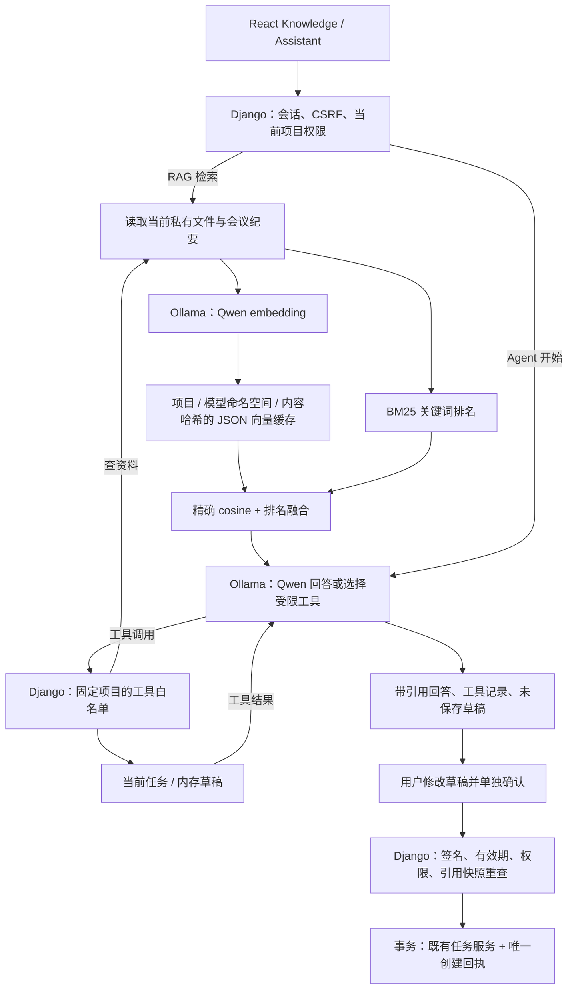

# StudyCrew AI 扩展：学校演示与项目讲解

本扩展把项目现有的私有文件、会议纪要、任务和成员权限接入 RAG 与受限 Agent。它保留 Django/DRF + React 的模块化单体架构；Ollama 作为独立模型服务负责推理，业务权限和任务写入继续由 Django 管理。

这里说明已实现的代码、运行入口和演示步骤。本地 GPU 与合成实测结果见 [真实模型验证记录](ai-validation.md)；公网部署仍需目标服务器验收。本文不推断个人贡献或通用准确率。

## 一条完整请求链



BM25 是默认路径，可以独立搜索。配置 hybrid 后才调用 embedding；语义服务不可用时保留关键词结果并告知回退。图中的向量缓存是应用数据库中的 JSON 字段，当前实现没有 pgvector、近似最近邻服务或模型微调。

## 各模块负责什么

| 位置 | 职责 |
|---|---|
| `knowledge/sources.py`、`parsing.py` | 读取当前授权材料，校验文件版本/扫描状态，在受限独立进程中解析 PDF/DOCX，保留版本与页码 |
| `knowledge/retrieval.py` | 英文词与中文双字分词、文本分块、BM25 排名和同源片段数量限制 |
| `knowledge/hybrid.py`、`models.py` | 校验并归一化向量，按项目/模型命名空间/内容 SHA-256 缓存；模型命名空间由名称、维度与权重摘要计算；精确 cosine 与 reciprocal-rank fusion；语义故障回退 |
| `knowledge/services.py`、`policies.py` | 问答编排，当前用户/成员授权，调用模型前后重查材料，限制引用标签 |
| `knowledge/output_guardrails.py` | 从已选来源识别带标签密码及常见令牌形式，拦截在模型回答或草稿中重复的字面量；原文预览仍按权限显示 |
| `knowledge/agent.py` | 四轮内的模型工具循环；工具固定为查项目资料、读当前任务、建议任务草稿 |
| `knowledge/actions.py`、`models.py` | 600 秒签名和引用快照；用户确认后的任务创建；锁、事务、唯一回执及重试内容校验 |
| `integrations/rag_model.py`、`rag_agent.py`、`rag_embeddings.py` | 唯一外部 HTTP 边界：固定配置的模型服务、超时、响应大小/结构校验、密钥与私有提示保护 |
| `frontend/src/api/knowledge.ts`、`assistant.ts` | 统一客户端请求、CSRF、禁止 HTTP 缓存、请求取消 |
| `ProjectKnowledgePage`、`ProjectAssistantPage` | 来源/任务引用、工具记录、可编辑草稿和确认窗口；页面内存状态、重复提交和跨项目迟到结果保护 |
| `scripts/Setup-StudyCrewAI.ps1`、`Start-StudyCrewAI.ps1` | 工作区模型安装、合成文本预热、本地应用/worker 启动与自有进程清理 |

## 可以讲清楚的实现边界

- **RAG**：先检索当前项目证据，再让模型基于选中的片段回答。支持最新 TXT/CSV、含文本 PDF/DOCX 和活动会议纪要；扫描 PDF、图片、XLSX/PPTX 和 ZIP 不参与这次检索。资料不足或引用无效时明确显示状态。
- **Hybrid**：BM25 保留明确关键词；Qwen embedding 提供语义候选。向量缓存只按当前候选内容取用，当前文件版本和成员权限另行重查。命名空间包含模型名称、维度与 `RAG_EMBEDDING_REVISION` 权重摘要，维度或配置摘要变化后分开使用缓存；启动器自动获取实际 embedding 摘要，手动/生产配置需在更换权重后更新。语义计算最多覆盖 200 个片段，采用精确相似度与排名融合，适合受限项目资料集；规模扩大需要重新评估索引和异步处理。
- **Agent**：模型根据工具返回结果决定下一步，而非只生成一段总结。服务器固定项目，拒绝未知工具和非法参数；最多四轮、六次工具调用、十二段保留证据、五份草稿，并受整体截止时间限制。
- **引用纠正**：最终回答缺少或误写引用时，在原四轮和同一个总时间预算内最多纠正一次；本地启动器总预算为 24 秒。纠正只使用已经读取的证据，不允许再次调用工具；失败后保留错误状态并不展示回答/草稿。
- **人确认后写入**：模型工具不创建任务。用户编辑标题和描述，再在单独窗口确认；签名绑定用户、项目、提案随机编号和引用快照，10 分钟后失效。创建走既有任务服务和同一事务回执。相同签名/内容的有效重试返回原任务，修改过的重试内容被拒绝；引用变化和项目归档也会拒绝。
- **隐私与权限**：私有响应不缓存；提示、回答和未确认草稿不存浏览器或历史表。数据库会保存向量缓存、实际确认创建的任务及回执摘要。远程模型配置会发送问题、选中资料及 hybrid 候选文本，须按实际部署选择可信服务；本地启动器绑定回环地址。
- **输出安全**：回答、资料、工具摘要和草稿以纯文本显示；来源链接只允许本站，创建结果链接还限定到当前项目/任务。引用标签合法只能证明来源编号有效，不能证明生成内容完全正确；仍需阅读原文。
- **凭据重复检查**：后端从已选来源片段识别带标签的密码、常见 API key/access token 等形式；模型在 RAG 回答、Agent 回答或建议草稿中重复这些字面量时会被拦截。当前有权限用户的来源预览仍可显示原文。这只是有限模式比对，不能当作完整 DLP、通用秘密识别或所有提示注入的防护。
- **运行预算**：RAG 检索/生成共享 24 秒预算，检索子预算为 8 秒；Agent 默认整体 22 秒，AI 启动器选择 24 秒。模型单次传输默认 15 秒、启动器选择 20 秒，并受剩余整体时间约束。超时/截断生成会被保留为失败状态，不展示半截回答；实际排队与数据库开销仍需在原有 30 秒 web-worker 限制下实测。

## 本地演示步骤

先完成 [README 的 Python/前端安装](../README.md#local-setup)。PowerShell 7 在仓库根目录运行：

```powershell
.\scripts\Setup-StudyCrewAI.ps1
.\scripts\Start-StudyCrewAI.ps1 -Demo -Port 8002
```

选定聊天模型是 `qwen3.5:9b-q4_K_M`，embedding 是 `qwen3-embedding:0.6b`。模型文件位于忽略目录 `var/ai/`；示例入口为 `http://127.0.0.1:8002/app/`，登录验证码在 `var/advance-preview-emails/`。演示模式使用独立数据；保留启动窗口，结束时用 Ctrl+C。安装脚本的合成预热成功不等同于真实 RAG/Agent 验收。

1. **准备证据**：在隔离项目上传一份人工编写的作业说明 TXT/PDF，或使用 [合成演示资料](../deployment/ai/demo-materials/release-requirements.txt)。记录一条明确的会议决定，例如“报告应增加接口设计图”，并保留一项相关进行中的任务。
2. **展示检索**：在 Knowledge 问“最终报告需要补充什么图？”。说明检索返回的文件版本、PDF 页码或纪要版本。开发者工具中的实际 `retrieval` 字段可区分 hybrid 与 BM25 回退。
3. **展示回答边界**：打开引用核对原文；再询问材料中没有的事实，检查实际无证据/不足状态。若模型未就绪或超时，展示源检索和错误状态，不替换为预写模型答案。
4. **展示工具循环**：在 Assistant 请求“查阅我们的会议决定和当前任务，建议最多两项有来源引用的新任务”。检查实际工具记录、已有任务引用和未保存草稿；只有模型实际调用工具的结果才算这一步证据。
5. **展示人工审批**：修改草稿标题和描述。点击 Create task 时先展示确认窗口，此时任务尚未创建；确认后打开真实任务，核对内容与来源。取消窗口应保持未保存状态。
6. **展示防护**：用未加入该项目的演示账户检查拒绝访问；修改引用源后尝试确认旧草稿应被拒绝。重复确认/断网重试的幂等行为以自动化测试或隔离实测回执证明，避免把令牌放进公开录屏和日志。

端口、模型和提问可按实际演示环境调整。步骤列出待检查的行为，不表示本次真实模型演示已经全部通过。

## 隔离实测与维护入口

保持模型服务的启动窗口，在另一个项目根目录终端运行：

```powershell
.\.venv\Scripts\python.exe scripts\evaluate_project_ai.py
```

默认报告写入 `var/ai/evaluation-latest.json`；用 `--output var/ai/evaluation-school-demo.json` 指定另一份记录。脚本在临时目录创建独立 SQLite、媒体和合成账号，记录选定模型摘要、预热、BM25/hybrid 的固定中英文来源排名、真实问答、缺失证据/嵌入指令案例，以及两个 Agent 请求。审批演练由脚本在临时数据中显式调用创建和同内容重放，记录是否为同一任务，不是模型自主写入。

这是服务层的小型冒烟评测。来源排名和关键词匹配不证明答案蕴含关系或通用准确率；必须人工核对输出。它不替代真实浏览器的确认窗口、MFA/CSRF、负载、GPU 显存和公网部署验收。报告中的 `checks_passed` 只表示脚本定义的条件，需要同时检查未自动判分的缺失证据和嵌入指令输出；这里没有写入任何运行结果。

使用目标实例/数据集的数据库环境，先检查派生数据的保留候选：

```powershell
.\.venv\Scripts\python.exe manage.py purge_knowledge_data
# 审核候选数量后才应用：
.\.venv\Scripts\python.exe manage.py purge_knowledge_data --execute
```

默认按创建时间保留向量 14 天、回执 30 天；每次每张表最多删除 1,000 行。`--embedding-days`、`--receipt-days`、`--limit` 可覆盖边界内参数。默认 dry-run 不修改数据，删除向量可重新生成，已创建任务不随回执清理而删除。维护应由运营明确运行或配置经过验证的定时任务，并与备份保留规则一并说明。

## 学校答辩与应聘讲解

可以这样介绍项目能力：“在现有团队协作系统上加入按项目权限检索的 RAG，结合关键词与向量语义排序生成带来源的回答；通过受限工具调用查询任务并提出草稿，再由用户编辑、确认后创建实际任务。模型服务和业务写入边界独立，权限、证据变化及重试回执由服务端控制。”

讲解时用一条真实请求串起页面、API、权限、检索、模型、引用和确认创建。说明为什么选择小规模精确 cosine、如何退回 BM25、如何防止跨项目读取，以及为什么模型没有任务写工具。描述个人贡献时另以实际职责和可核对记录为准，本文不替代贡献证明。

本地合成实测已有 [原始记录和结果](ai-validation.md)；公网发布时还需记录以下目标环境证据：

| 证据 | 应记录内容 |
|---|---|
| 运行环境 | 分支/提交、模型摘要、运行时版本、GPU/CPU 实际 offload、上下文与输出限制 |
| 检索 | 固定中英文问题与预期来源、实际 top-k、hybrid/回退状态、缺失证据行为 |
| RAG 与 Agent | 真实问题/结果、引用核对、实际工具顺序、失败和超时处理 |
| 审批 | 修改与取消、确认前后任务状态、有效期/源变化拒绝、同签名回执重试 |
| 性能 | 冷/热启动、缓存首建/命中、端到端延迟、代表性并发和峰值显存；分别记录测量条件 |
| 部署 | 实际域名、TLS、SMTP、数据库角色、模型隔离、备份和独立恢复 |

GPU 服务、模型磁盘、同机/分机 HTTPS 接入和生产限制见 [AI 部署说明](../deployment/ai/README.md)。学校的原有部署和提交流程继续参考 [Assignment 3 runbook](assignment-3/deployment-runbook.md)，AI 配置包不等于已上线证据。
